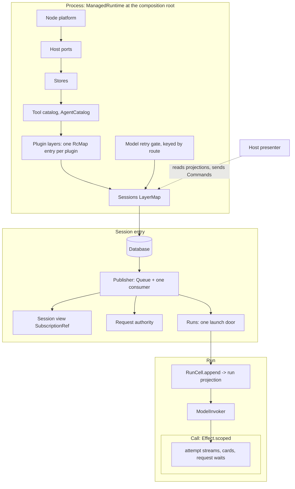

# Core concepts: thirteen nouns, one owner each, laid out on Effect lifetimes

This note defines the vocabulary the rest of the architecture is checked
against: what each core concept is, its lifetime, its Effect shape and the
module that owns it, the invariants that hold between them, and the Effect rules
that keep them. Paths are under `packages/harness/src/` unless they name another
package.

## Names

- **History** is the append-only rows, and the only truth for run and session
  facts. Current values are a separate authority (invariant 9). The run's
  history is one run aggregate's slice of it, always qualified (`RunHistory`,
  `runHistory`).
- **Projection** is anything computed from history. The code calls its
  projections folds (`foldRunState`, `sessionFold.ts`).

Three words the code uses for different things are kept apart:

| Word in the code                     | Means                          | Name here     |
| ------------------------------------ | ------------------------------ | ------------- |
| `RuntimeRequest`                     | host → core commands           | **Command**   |
| `HostRequest`                        | core → host capabilities       | **Host port** |
| `request.opened` / `request.decided` | a wait on a human or authority | **Request**   |

Inside a run, a **turn** is one user or synthetic input answered by the model,
and a **step** is one model call.

## The concepts

| Concept               | Definition                                                                                                                                                                                                                                                                                                                                                                                     | Lifetime and scope                                                                                     | Effect shape                                                                                                                         | Owner                                                                                                                                     |
| --------------------- | ---------------------------------------------------------------------------------------------------------------------------------------------------------------------------------------------------------------------------------------------------------------------------------------------------------------------------------------------------------------------------------------------- | ------------------------------------------------------------------------------------------------------ | ------------------------------------------------------------------------------------------------------------------------------------ | ----------------------------------------------------------------------------------------------------------------------------------------- |
| **Process**           | One Effect graph per OS process: host ports, stores, catalogs and sessions                                                                                                                                                                                                                                                                                                                     | process: a `ManagedRuntime` at each host's composition root                                            | `processLayer`; hosts build one `ManagedRuntime` over it; the SDK composes it through `Sessions.layer` and never owns a runtime      | `effect/processLayer.ts`, `platform/processRuntime.ts`                                                                                    |
| **Session**           | One storage root: its history, publisher, projections, live runs and requests. A conversation is a root run inside it                                                                                                                                                                                                                                                                          | session: a `LayerMap` entry, closed explicitly                                                         | `Sessions` over a `LayerMap` keyed by root                                                                                           | `controllers/session/sessionLayer.ts`, `agent/runtime/SessionHandle.ts`                                                                   |
| **History**           | Append-only rows per aggregate, in root-wide commit order. One publisher per (process, root). The claim holder is the only appender of an aggregate                                                                                                                                                                                                                                            | durable; each row kind carries its own version                                                         | the `SessionEvents` publisher: a `Queue` inbox and one consumer fiber, whose doors are `transact`, `detach`, `removeRun` and `drain` | `agent/runtime/SessionEvents.ts`, `shared/schemas/sessionEvent.ts`; claims in `controllers/session/Database.ts`                           |
| **Projection**        | Anything computed from history. Two named ones: the **run projection** (strict; the resume authority) and the **session view** (tolerant; display only)                                                                                                                                                                                                                                        | run projection: a value per run; view: session                                                         | run projection: the `RunState` that `RunCell.append` returns, never a `Ref`. View: a `SubscriptionRef` written by one fiber          | `shared/session/runStateFold.ts`, `shared/session/sessionFold.ts`                                                                         |
| **Run**               | One `run` aggregate with an identity and a parent edge, opened with an agent definition. Its tools and continuation are pinned per step. A child run is a run with a parent edge                                                                                                                                                                                                               | run: launched on the session's context; its history lasts beyond it                                    | a run `Layer` (`AgentRun`, `ModelInvoker`) launched through one door, `session.runs.launch`                                          | `agent/runtime/loop/toolUse.ts`, `agent/runtime/run/AgentRun.ts`, `agent/runtime/runRegistry.ts`, `agent/runtime/childRunLoop.ts`         |
| **Input**             | Every message to a run: user, child report, peer, subscription notice, or a turn opened by a continuation. Each is a `followup.queued` row on the run's aggregate, with its sender in `from`                                                                                                                                                                                                   | row until `followup.consumed`                                                                          | a value on the run's own entry, passed explicitly; **never a context tag**                                                           | `agent/followUp/` (`Inbox.ts`), `agent/runtime/FollowUps.ts`                                                                              |
| **Agent**             | A resolved definition (settings, prompt, declared tools) from an ordered catalog of sources: built-in, custom, `plugin:<id>`, or an inline persona recorded on the run                                                                                                                                                                                                                         | catalog: process; definition: recorded at run open                                                     | the `AgentCatalog` process service                                                                                                   | `agent/index/agentCatalog.ts`                                                                                                             |
| **Plugin**            | A `Plugin` value (`definePlugin`): tools, continuation, prompt section, process and session layers, availability probe, switch, plugin-fact arms and an agent-file block. The harness's built-ins and TeXRA's app plugins are lists of these values. Third-party plugins are data (the Claude Code / Codex layout), MCP servers and out-of-process hooks. No third-party code loads in process | a field's value type is its lifetime (rule R4)                                                         | no runtime object of its own; its layers are `RcMap` entries in the catalog                                                          | `tools/plugins.ts`, `tools/builtinPlugins.ts`; the app's list in `packages/texra`                                                         |
| **Composition**       | What a run is offered at a step: the pinned catalog generation (tools and continuation, with plugin ids and revisions) narrowed by the agent's tools, the host and probe results. A child records its own narrower offered set                                                                                                                                                                 | generation: pinned per step, held until the run's next step pins; plugin layers: an `RcMap` entry each | the tool catalog (`ToolCatalog`) and the step                                                                                        | `tools/liveTools.ts`, `tools/sessionTools.ts`, `agent/runtime/loop/step.ts`                                                               |
| **Call**              | A model call or a tool call inside a run. A model call is binding → invoker → attempt, gated, priced and retried, with `ModelInvoker` its only caller. A tool call is offered set → guard → request → result, with a loop-owned card                                                                                                                                                           | call: `Effect.scoped` per attempt or tool call                                                         | scoped handles for streams, cards and request waits                                                                                  | `agent/runtime/ModelInvoker.ts`, `agent/runtime/modelAccess/`, `agent/runtime/loop/toolUseDispatch.ts`, `agent/runtime/loop/toolGuard.ts` |
| **Request**           | A wait on a human or authority (approval, retry, question). The decision is committed as a row; the wait is a call-scoped `Deferred`. Approval policy and grants are rebuilt from rows                                                                                                                                                                                                         | authority: session; each wait: call                                                                    | decisions are rows                                                                                                                   | `controllers/session/SessionRequests.ts`, `agent/runtime/runApprovalQueue.ts`                                                             |
| **Host**              | **Ports** (process-layer inputs: secrets, editor model, dialogs) plus a **presenter** (a scoped program that reads projections and sends Commands). It decides no recorded fact                                                                                                                                                                                                                | ports: process; presenter: window or activation scope                                                  | ports: layers; presenter: an Effect over `Sessions`                                                                                  | `packages/{extension,desktop,cli}`; host-side session controllers in `packages/texra/src/controllers/session/`                            |
| **Application state** | Settings and app state that are current values, not history                                                                                                                                                                                                                                                                                                                                    | durable                                                                                                | `CurrentValues`, one `modify` per write                                                                                              | `controllers/session/currentValues.ts`; the [current-value decision](./2026-09-22-current-value-state-decision.md)                        |

Not concepts in their own right:

- **Pin** is a property of Step: the step's hold on a catalog generation,
  recorded on `tools.offered` when it changes.
- **Continuation** is a plugin contribution that each step pins and records, so
  switching it applies at the next step. It is one source of Input.
- **Claim** is History's write authority per aggregate.
- **Trace** is the run's producer of display rows.
- **Workspace roots** are the Session key plus a Host port.
- **Output** is the documents plugin's facts, which hosts present.

## Central primitives

The owner ruled on 2026-09-27 that TeXRA supports live changes at any step,
third-party plugins that bring code, and flexible writers of history. These
primitives make that one mechanism instead of one per pluggable kind.

1. **Catalog: one generational catalog of what plugins contribute.** Tools and
   continuations live in one `ToolCatalog` (`tools/liveTools.ts`). Any change
   rebuilds a new generation; old generations live while a step pins them, then
   drain. A plugin list that repeats a plugin id or a tool name, or claims the
   continuation twice, is refused when its table is built (`toolTable`,
   `tools/toolTable.ts`).
2. **Plugin: one scoped contributor.** A first-party plugin is a `Plugin` value
   of the shape above, passed to `Sessions.layer({ plugins })`. Installed Claude
   Code and Codex plugins and MCP servers load as data, and their hooks run out
   of process. Switching a plugin off withdraws its contributions at the next
   step while old generations drain.
3. **History: one commit line, typed plugin arms.** A plugin's durable state is
   typed arms of the one closed event schema, written as `plugin.fact` through
   the one publisher (`Plugin.arms`). Each row kind, plugin-owned kinds
   included, carries its own schema version, with upcasters registered with the
   schema and run at the read boundary.
4. **Step: the one boundary where change happens and is recorded**
   (`loop/step.ts`).
   - A step pins the catalog generation the run uses.
   - Before the model request it writes a `tools.offered` row when the offered
     set, the continuation, the hooks or the frozen context differ from what the
     run last recorded.
   - A tool's identity is its name, its input schema with descriptions stripped,
     its plugin id and its plugin revision. A call to a tool that is gone or
     changed settles as `tool_unavailable`; the run is not failed.
5. **Trust: a recorded decision for anything that loads.**
   - Every loaded plugin revision needs a trust decision, recorded as a row.
   - Approving a plugin's hooks trusts a child process that can do anything the
     user can in the workspace. There is no narrower grant.
   - **The trust revision is not the config revision.** A hooks plugin's or a
     stdio MCP server's trust revision includes a content digest of what
     actually runs. The config revision (`sha256({spec, envHmac})` for MCP,
     `builtin` for built-ins) is used only for tool identity and stale-call
     checks.
   - Third-party code runs out of process, as Claude Code hooks
     ([hooks v1](./2026-09-28-code-plugins-hooks-v1.md)). A typed Effect RPC
     boundary for plugins is not built until a named plugin cannot be MCP +
     hooks + data (rulings ledger, D11).

## Invariants

1. **One writer.**
   - Per (process, root), every durable append is a job on the one publisher,
     and commit order is enqueue order.
   - Per aggregate, only the claim holder appends.
   - A run's history is written through its `RunCell.append`, `run.end` through
     `finalizeRun` (`agent/storage/runLifecycle.ts`), and request rows through
     the request authority.
   - Claims and GC stay in SQL.
2. **History is the only truth for run and session facts.** Current values are a
   separate authority (invariant 9).
   - A fact is one row type.
   - A persisted derivation is admissible only as a checkpoint that rows rebuild
     and that loses every conflict with them.
   - What reached the model can be rebuilt from the run's rows: the system text,
     the exact tool declarations offered, the composition with plugin revisions,
     and the agent definition, stored once as `context.blob` rows
     (`run/requestContext.ts`). In development and CI the invoker checks, before
     a request leaves the process, that the rows it committed rebuild the turn
     it sends (`checkRecordedRequest`).
   - A refused or failed run-history write ends the run (`findStorageRefusal`,
     `shared/session/runHistory.ts`).
3. **Decisions read the run projection or the publisher, never the session
   view.** The view is for display.
4. **One owner, one lifetime.** Every piece of mutable state is a Layer or a
   scoped value at exactly one lifetime: process, session, run, call, or host
   scope. There are no module variables and no WeakMaps keyed by another
   concept's handle.
5. **No ambient reads across instances.** A run never reads another run's state
   from context. A child is launched from the session's context, not from its
   parent's fiber.
6. **Plugins contribute typed entries.**
   - Each extension point has one core call site that reads it through the
     step's pinned generation.
   - There are no untyped in-process hooks and no ordered listener chains.
   - A plugin's switch withdraws every contribution it made: tools, skills,
     agents, continuation, prompt section and layers.
7. **Changes apply at step boundaries and are recorded; the durable run and its
   activations are separate contracts.**
   - Each step pins a generation and records the difference from the previous
     step before its model request. Nothing changes mid-call.
   - A child may only narrow what its parent's step offered, and records its own
     offered set.
   - A run can have several activations. The recorded facts belong to the
     durable run; the resources belong to the activation.
   - **Resume offers the recorded tools that are still available and still the
     same tool.** This keeps the ruled `recorded ∩ available` rule
     ([rulings ledger](./2026-08-01-architecture-rulings-ledger.md), 2026-09-23:
     a resumed run resolves its own composition) and adds the identity check. A
     changed or missing tool is not offered, and a call to it gets
     `tool_unavailable`.
   - **Blocked, not failed.** A resume whose agent is missing from the catalog,
     or comes from an installed plugin that is off or not trusted, leaves the
     run interrupted with a reason in the projection, and the session resumes it
     once the catalog has it again (`agent/runtime/resumeBlocker.ts`).
8. **Core decides; hosts present.** Any decision whose result is recorded
   (request decisions, admission, outcomes) is made in core and committed as a
   row. A host supplies a human's answer as a Command. Pure presentation
   subscribes afterwards and cannot change a verdict.
9. **One authority per kind of fact.** Resumable execution facts live in
   history. Settings and other current values live in `CurrentValues`. Transient
   observations such as stream chunks live on the live trace and are never rows.
10. **One shutdown protocol, owned by core.** Core stops admission, drains
    accepted deliveries, settles runs and releases resources, in that order,
    within `SESSION_CLOSE_DEADLINE_MS` (`controllers/session/sessionLayer.ts`).
    Past it, remaining work is interrupted and the incomplete cleanup is
    reported. Explicit session close follows the same protocol. Plugins acquire
    and release their resources in their layers, ordered by layer dependencies,
    not hooks.

## Effect rules

- **R1. Tag or value.** A `Context.Service` must satisfy all three:
  1. it is a capability, not an identity or state;
  2. its provider is fixed for its whole lifetime;
  3. every fiber that can inherit it, a forked child run included, would be
     right to use the same provider.

  Everything that identifies or belongs to one instance is a value on its owner,
  passed as an argument: `runId`, the inbox, `ApprovalState`, a request's
  `Deferred`. `Effect.serviceOption` is for optional process ports only: it has
  `R = never`, so an inherited run- or session-lifetime tag never shows up in a
  type.

- **R2. One launch door.** Every run starts through `session.runs.launch`,
  forked from the session's context. Every Effect fork starts with the caller's
  context, so a run forked from a tool-call fiber would read that call's
  run-scoped services as its own. A child's link to its parent is data.
  `runLaunchDoorRatchet` holds the rule.
- **R3. `R` versus arguments.** Put in `R` the capabilities whose provider is
  fixed for the enclosing lifetime. Pass as arguments anything that selects an
  instance, carries per-call data or holds per-instance state. Never add a tag
  to avoid threading a parameter.
- **R4. A field's value type is its lifetime.**
  - Step lifetime: tools, continuations and prompt sections, pinned with a
    catalog generation.
  - Process lifetime: a plugin's `processLayer`, built once in its own `RcMap`
    entry and shared by every generation that holds the plugin.
  - Session lifetime: a plugin's `sessionLayer`.
  - Data: a plugin's `arms`, each with its version.
- **R5. One writer, in code.** Only the publisher appends; a read-modify-append
  is one job on its inbox. Ordering comes from the queue and `withPerKeyLane`,
  never from `Semaphore(1)`, which barges. `persistenceWriteBoundary` refuses
  any other file a connection or SQL that writes the session tables.
- **R6. Exposing projections.**
  - `SubscriptionRef` is for presenters. Admission and every other decision read
    the run projection or the publisher (invariant 3).
  - A row `Stream` is for readers that need every row in order: NDJSON, export,
    SDK events and resume.
  - One fiber writes each projection. `getUnsafe` is allowed only at a
    synchronous host boundary.
- **R7. Effect's `unstable/*` modules** are admitted by family in the rulings
  ledger ("Effect submodules"). `eventlog`, `workflow`/`cluster` and `ai`
  duplicate history, run-history resume and `packages/llm`, and stay out.
- **Other rules.**
  - Every service method is an `Effect.fn('Owner.method')`.
  - Errors are `Data.TaggedError`. `Error` is allowed only at host ports.
  - In-memory lifecycle states are `Data.TaggedEnum`, not optional-field bags.
  - A `ManagedRuntime` exists only at composition roots.

## Layer graph

The lifetimes nest as process ⊃ session ⊃ run ⊃ step ⊃ call. A catalog
generation is process-owned and held by the steps that pin it. Host scopes run
parallel to sessions.

## Rulings

Ruled 2026-09-27 (the owner delegated these and asked for the long-term option
each time):

- **Third-party code plugins run out of process.** Data plugins load as data;
  code plugins speak the hooks protocol. Trust keys on a revision that includes
  a content digest of what runs, separate from the config revision used for tool
  identity.
- **Format policy: a version per row kind**, plugin-owned kinds included, with
  upcasters registered with the kind's schema and run at the read boundary, so
  one plugin's schema change does not reset everyone's history.
- **Changes apply at the next step boundary and are recorded.** Settings read
  mid-run follow the same rule.
- **Goal mode after resume** is paused until the user re-arms it.
- **Descriptions are not part of tool identity.**

Ruled 2026-09-30 (decision board; the rulings ledger carries each with its
reason and reopen trigger):

- A preset is saved switches plus an optional root agent. The words "roster" and
  "multi-agent preset" retire.
- Plugin skills and agents are gated by the plugin switch.
- Typed RPC, `History.writer` and the open schema registry are not built until a
named plugin cannot be MCP + hooks + data. The 2026-10-02 durable-harness ruling
narrowed the same ruling's `PluginModule` half: a first-party plugin is a code
value ([durable harness](./2026-10-02-durable-harness.md), "Owner rulings").
</content>

</invoke>
