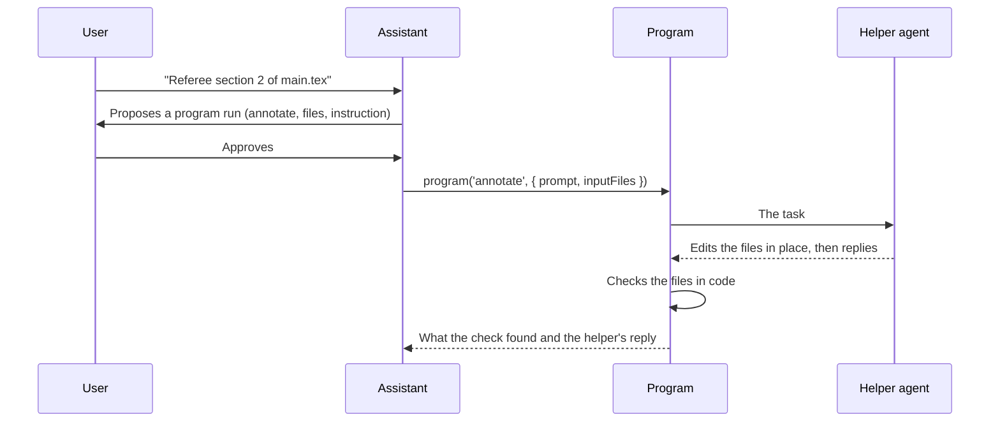

# Programs: how they work

A program is a short script a plugin ships. A person or the assistant starts
it by name; it starts helper agents, and it checks their work in code. That
check is the reason it is a program and not a sentence of a prompt. For the
list of programs, read [The assistant and programs](./programs.md).

A program is started in one of two ways:

- you ask the assistant, which proposes the run for you to approve;
- `texra run <program> --input …` in the terminal.

## What a run does

1.  **One helper.** The program gives it a system prompt, the
    tools the job needs (file tools and the shell, and for Lean the Lean
    tools), your instruction and the file names. The helper reads and edits
    the files in your project directly and works until it calls the job
    done. You can follow it in the [Tasks view](./progress-board.md).
2.  **A coded check.** `annotate` compares each file with what it was when
    the program started and looks for anything but added `\criticize{}`
    comments.
    `prove` and `lean-simplify` ask Lean for errors, `sorry` and new axioms.
    `blueprint` runs `leanblueprint web` and `leanblueprint checkdecls`.
    `write-up` checks that the note states the claim as it was given and
    that the working files did not change.
3.  **The answer.** The program reports what the check found beside the
    helper's reply, so the answer says plainly when the work is not
    finished, whatever the helper said of it.

`transcribe` and `lean-search` run one helper and answer with its reply.

Nothing is staged in run storage and there is no accept step: the files in
your project are the result. Review them with your editor or `git diff`, and
commit before a large change if you want an easy way back.

## Anything else is a script

Several revision rounds with a critic between them, several candidates
written in separate copies of the project, a compile after every change, a
`latexdiff` against the original: the assistant writes these itself as a
[script](./multi-agent-workflows.md) over helper agents and the shell. Ask
for the procedure you want in plain words.
