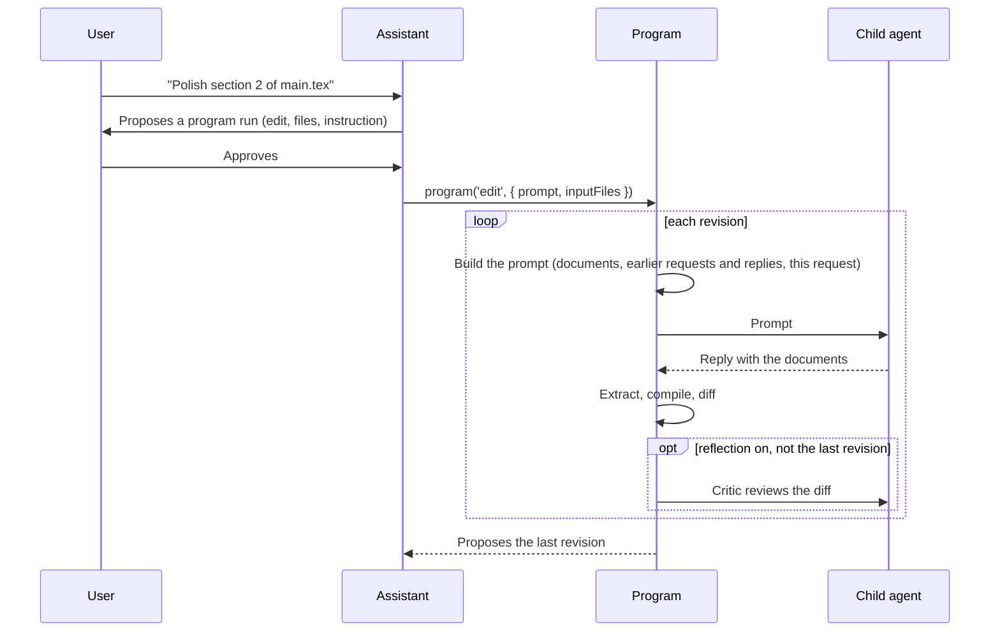

# Programs: how they work

A document program (`edit`, `annotate`, `enhance`, `apply`, `merge`,
`transcribe`, `slides`, `poster`) takes your input files, read-only context
files and instruction, has a model write each revision, and writes versioned
diffs to run storage. This page covers the stages of a program run and the
optional critic. For the list of programs, read
[The assistant and programs](./programs.md).

::: tip When to run a program
Programs are built for **deep, single-shot work**: rewriting a whole section,
converting a paper to slides, or merging edits. Each revision produces the
full documents, and most programs review the first revision in a second one,
so runs with frontier reasoning models can take **10–30 minutes**.

For a faster turnaround, pick a **smaller or faster model**: quality drops
somewhat, but wall-clock time drops a lot. For short edits or questions, just
ask the assistant in the chat: it answers in seconds and skips the document
pipeline. For a problem too big for one run, the assistant can start several
programs at once; read [Multi-agent workflows](./multi-agent-workflows.md).
:::

A program is started in one of three ways:

- you ask the assistant, which proposes the run for you to approve;
- `texra run <program> --input …` in the terminal;
- the **Merge** action, which starts `merge`.

The Lean programs (`prove`, `lean-simplify`, `blueprint`, `lean-search`) are
described in [Lean 4 proofs](./lean.md#lean-programs); the task programs
(`review`, `derive`, `fix-latex`, …) hand the job to one helper agent and
return its report. The rest of this page is about the document programs.

## Basic execution flow

A document program orchestrates revisions in code: for each revision it builds a prompt, invokes a fresh helper agent, and extracts, compiles, and diffs the documents from the reply:

**Key stages of a revision:**

1.  **Prompt construction:** TeXRA builds one message from the program's opening text, the files you selected, your instruction, each earlier request with the reply it got, and this revision's request. The program supplies the child's system prompt.
2.  **Child agent:** A fresh child agent answers the prompt with the final documents wrapped in the fixed `<documents><document name="...">...</document></documents>` container. You can follow this in the [Tasks view](./progress-board.md), where each revision's agent call shows as a child run.
3.  **Extraction:** TeXRA saves the raw reply (as `r{n}/output.xml`, where `r0/` is the first revision). It then extracts the content of each `<document name="...">` entry into its own file under the revision's directory in run storage, named after that entry's `name` (an `edit` run on `paper.tex` produces `r0/paper.tex` for the first revision and `r1/paper.tex` for the second; a `<document name="chapters/main.tex">` entry lands as `r{n}/chapters/main.tex`; only the raw reply uses the fixed `output.xml` stem, and a document literally named `output.tex` is renamed `output_extracted.tex` so it cannot clobber it).
4.  **Compile check and diff:** For LaTeX files, TeXRA compiles each output and generates a `latexdiff` file comparing it to its input. Read the [LaTeX Diff guide](./latex-diff.md) for details.
5.  **Optional critic:** With reflection on, a critic reviews every revision but the last (see below).
6.  **Proposal:** When the last revision is done, TeXRA proposes one revised document per input file for you to accept. `transcribe`, `slides` and `poster` propose the new document they wrote instead.

The same pipeline runs headlessly from the terminal:

<CliRunHero
  command="texra run edit --input paper.tex --instruction 'Polish the prose' --output paper.polished.tex"
  :rounds="[
    { label: 'Revision 1: draft', state: 'done' },
    { label: 'Revision 2: review pass', state: 'done' },
  ]"
  :outputs="['paper.polished.tex']"
  note="Same program, same revisions, same run storage: no UI attached."
/>

Each revision's reply and documents land in their own folder under run storage, with the diffs beside them:

<RoundOutputTree />

Every revision saves the raw <code>output.xml</code> and one extracted file per <code>&lt;document name&gt;</code> (named after the input file, for example <code>paper.tex</code>). <code>r0/</code> is the first revision (the draft); <code>r1/</code> is the review pass. The <code>latexdiff</code> source of each revision is under <code>diff/</code> and its compiled PDF under <code>output/</code>.

**Output limit:** If the reply is cut off by the model's max output tokens before the closing `</documents>` tag, TeXRA keeps what the model wrote as that revision's output and warns in the transcript that it may be incomplete. Raise the model's max output tokens if a long document gets cut off.

### What goes into the prompt

Each revision's prompt is one message holding the conversation so far: the program's opening text with the content you selected, then each earlier request with the reply it got, then this revision's request (with the compile errors that failed the last revision, when failed compiles are rejected). Figures and audio files are sent alongside the text for models that support them.

A `program` call can switch on extra context with `args`, each a boolean: `attachTeXCount` adds word counts, `autoExtractFigure` and `autoExtractTikzFigure` attach the figures the input includes, and `autoCompileInputPdf` attaches the compiled input PDF.

### Built-in review pass

Each program fixes its own number of revisions. `edit`, `annotate`, `enhance`, `transcribe`, `slides`, and `poster` run two: a first revision (`r0/`), then a review pass (`r1/`) that rereads the first revision against the original and outputs the corrected documents. `apply` and `merge` run one. A run ends earlier only on failure or cancellation.

`annotate` also checks each revision itself: when a revision changes text outside its `\criticize{}` comments, the next revision is told to restore the original.

### Optional critic review (`reflect`)

Started with `args: { reflect: true }` on a `program` call, a program inserts an independent critic between revisions. After each revision (except the last) is compiled and diffed, the critic reads the requests so far, the diff against the original input, and the compile result, then returns grounded corrections tied to locations plus one high-value optional improvement. The next revision's prompt carries that critique in a `<critique>` block. The revision count stays the same, so `reflect: true` has no effect on single-revision programs (`apply` and `merge`).

::: warning Potential XML Issues
Occasionally an LLM generates slightly malformed XML, especially for very long or complex outputs. TeXRA closes an unclosed `<document>` tag itself and tries to recover untagged files, and it keeps every revision's raw reply (`r{n}/output.xml`, for example `r0/output.xml`). If a file still fails to extract, open that `.xml` file to recover the text. Read the [Troubleshooting guide](./troubleshooting.md#missing-or-truncated-output-files) for details.
:::

### Second-revision diff example

After the first revision (`r0/`), a two-revision program evaluates and refines its work in the second (`r1/`):

  

    <button type="button" class="pdf-tab" data-pdf="/examples/draft_polish_r0_gemini25p_diff.pdf">Original vs. revision 1</button>
    <button type="button" class="pdf-tab" data-pdf="/examples/draft_polish_r1_gemini25p_diff.pdf">Original vs. revision 2</button>
    <button type="button" class="pdf-tab active" data-pdf="/examples/draft_polish_r1_gemini25p_diffr1r0.pdf">Revision 1 vs. revision 2</button>
  

  <iframe src="/examples/draft_polish_r1_gemini25p_diffr1r0.pdf" id="pdf-frame" class="reflection-pdf-frame"></iframe>
  <a href="/examples/draft_polish_r1_gemini25p_diffr1r0.pdf" target="_blank" id="pdf-link" class="reflection-pdf-link">View full example</a>

  
Red strikethrough: first-revision content revised in the second

  
Blue underlined: New/improved content added in the second revision

