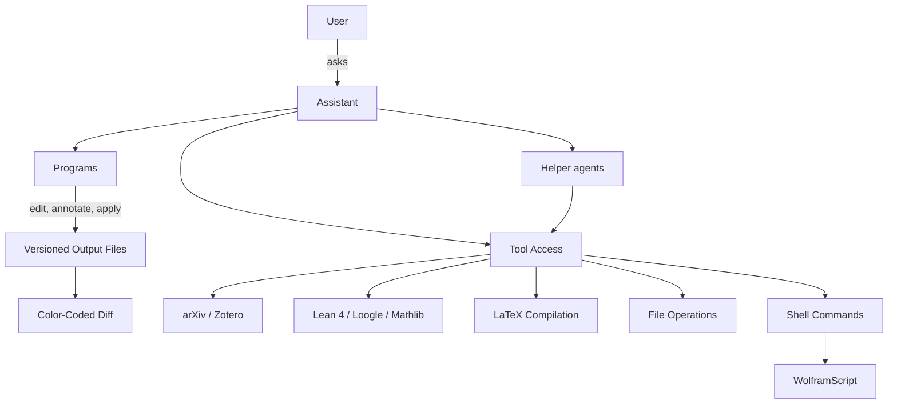

# TeXRA

An open-source AI theorist for VS Code, desktop, and the terminal. It handles
real theory work: deriving results, checking derivations in Wolfram, and
formalizing proofs in Lean 4, splitting large jobs across helper agents and
programs. Manuscript preparation, LaTeX tooling, and figures sit alongside your
research project.

<GuideIntroHero />

A single task, split across three programs in the TeXRA view. Select a delegation to see what it produced.

## Get started

- [**Installation**](./installation.md): VS Code extension, desktop app, or the `texra` CLI
- [**First run**](./first-run.md): open a `.tex` file, watch one program work
- [**Quick start**](./quick-start.md): the longer walkthrough in VS Code
- [**Desktop app**](./desktop.md): standalone app (coming soon)

## Use it

| Task                                       | Workflow                                                                     |
| ------------------------------------------ | ---------------------------------------------------------------------------- |
| Verify proofs and derivations              | `review` program, see [Programs](./programs.md#task-programs)                |
| Formalize in Lean 4                        | [Lean 4 proofs](./lean.md)                                                   |
| Search literature, no fabricated citations | the assistant or `search` program, see [Research tools](./research-tools.md) |
| Tighten prose in a draft                   | [Polish a draft](./workflows/polish-a-draft.md)                              |
| Fix typos, grammar and notation            | `edit` program, see [Programs](./programs.md#document-programs)              |
| Build slides from a paper                  | `slides` program, see [Programs](./programs.md#document-programs)            |
| Generate TikZ figures                      | [TikZ figures](./tikz-figures.md)                                            |

## Understand the system

- [**The assistant and programs**](./programs.md): what you can ask for, and every program
- [**Programs: how they work**](./agent-architecture.md): revisions, the critic, run storage
- [**Multi-agent workflows**](./multi-agent-workflows.md): how the assistant fans work out in parallel
- [**Models**](./models.md): picking a model for the job
- [**Tailoring TeXRA**](./customizing.md): project instructions, skills, plugins and your own programs

## Why multi-agent

Theoretical work depends on long chains of steps: a sign error in Section 3
breaks Appendix C, a Lean proof needs the right lemma to close a goal, and a
numerical script has to match an analytical formula. The manuscript has its own
constraints: uniform notation across sections, real citations in BibTeX, and
figures that compile cleanly.

General-purpose chatbots struggle with this:

- **Hallucinated citations**: without grounded search, models invent references.
- **Lost structure**: a single prompt rarely keeps theorem environments, `\label`/`\ref` links, BibTeX, and multi-file projects straight at once.
- **No verification**: raw text output gives you no way to check an algebra step, type-check a proof, or diff what changed.
- **No tools**: no WolframScript, no Mathlib search by type signature, no compiler in the loop.

TeXRA's assistant and programs call real tools and return verifiable output.

## Three apps, one system

The VS Code extension, the desktop app, and the `texra` CLI share the same
assistant, programs, credentials, and task history. A task started in the CLI appears live in
the extension and desktop **Tasks** list, and vice versa.

<RunParityHero />

The same task appears live across the terminal and the extension's Tasks list.

TeXRA works in two ways:

<AgentClasses />

A document program runs a structured pipeline and returns a diff; the assistant works conversationally with grounded tools and starts task programs.

TeXRA combines three mechanisms: **reflection** (critiquing and revising output),
**tool use** (checking work against compilers, language servers,
and search APIs), and **planning** (breaking a problem into steps and adapting
as results come back).

## Who uses TeXRA

<FeatureCards
  min="220px"
  :cards="[
    {
      icon: 'book',
      title: 'Mathematicians',
      desc: 'Complex theorem environments, notation consistency across long proofs, Lean 4 formalization.',
    },
    {
      icon: 'bolt',
      title: 'Theoretical physicists',
      desc: 'Multi-file manuscripts with heavy equation environments, Feynman diagrams, large bibliographies.',
    },
    {
      icon: 'chart-line',
      title: 'Computational scientists',
      desc: 'Numerical methods, algorithm descriptions, convergence plots, reproducible workflows.',
    },
    {
      icon: 'graduation-cap',
      title: 'PhD students',
      desc: 'Thesis chapters with consistent notation, literature surveys in new subfields, talks from written work.',
    },
    {
      icon: 'users',
      title: 'Research groups',
      desc: 'Collaborations where every change is traceable and auditable by co-authors and referees.',
    },
  ]"
/>

## Privacy and data handling

**Bring-your-own-key mode.** API calls go directly from your machine
to the model provider you chose. TeXRA does not sit between you and
the provider. Your unpublished proofs, manuscripts, and API keys
never leave your machine except to the provider endpoint.

**Provider subscriptions** (ChatGPT, Grok, Kimi Code and the GLM Coding
Plan). Requests still go straight from your machine to that provider:
ChatGPT and Grok via OAuth sign-in, Kimi Code and the GLM Coding Plan via a
plan-specific key. ChatGPT and Grok connect from the **Settings → Models →
Subscriptions** tab (or `texra auth chatgpt login` / `/login` in the CLI); Kimi
Code and the GLM Coding Plan take their key under **Models → API keys**.

API keys, whichever mode you use, stay on your machine, in one owner-only
`secrets/` folder under `~/.texra` that the extension, the desktop app and the
CLI share (readable by your user alone; not keychain-encrypted). You can also supply them via environment
variables or a `.env` file in your project.

## Support

Issues and feature requests: [GitHub](https://github.com/LionSR/TeXRA).
Contact: [contact@texra.ai](mailto:contact@texra.ai).
