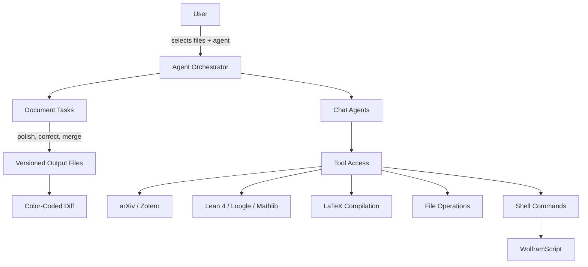

# TeXRA

An open-source AI theorist for VS Code and the terminal. It
attempts real theory work: deriving results, checking derivations in
Wolfram, and formalizing proofs in Lean 4. It takes on open problems in
long autonomous runs with a team of specialist agents, helping you do
good, verifiable work. Manuscript preparation, LaTeX tooling, and figures
serve as supporting capabilities within your research project.

<GuideIntroHero />

A single task, split across three specialists in the Sessions view. Select a delegation to see what it produced.

## Get started

- [**Installation**](./installation.md): VS Code extension or the `texra` CLI
- [**First run**](./first-run.md): open a `.tex` file, watch one agent work
- [**Quick start**](./quick-start.md): the longer walkthrough in VS Code

## Use it

| Task                                       | Workflow                                                     |
| ------------------------------------------ | ------------------------------------------------------------ |
| Verify proofs and derivations              | `review`, see [Built-in agents](./built-in-agents.md)        |
| Formalize in Lean 4                        | [Lean 4 proofs](./lean.md)                                   |
| Search literature, no fabricated citations | `assistant`, see [Research tools](./research-tools.md)       |
| Tighten prose in a draft                   | [Polish a draft](./workflows/polish-a-draft.md)              |
| Fix LaTeX errors and notation              | `correct` agent, see [Built-in agents](./built-in-agents.md) |
| Build slides from a paper                  | `paper2slide`, see [Built-in agents](./built-in-agents.md)   |
| Generate TikZ figures                      | [TikZ figures](./tikz-figures.md)                            |

## Understand the system

- [**Built-in agents**](./built-in-agents.md): the full catalog
- [**Agent architecture**](./agent-architecture.md): document tasks vs. chats, reflection, planning
- [**Multi-agent workflows**](./multi-agent-workflows.md): how a team lead fans work out to specialists in parallel
- [**Models**](./models.md): picking a model for the job
- [**Custom agents**](./custom-agents.md): define your own in YAML

## Why multi-agent

Theoretical work depends on long chains of steps: a sign error in Section 3
breaks Appendix C, a Lean proof needs the right lemma to close a goal, and a
numerical script has to match an analytical formula. The manuscript has its own
constraints: uniform notation across sections, real citations in BibTeX, and
figures that compile cleanly.

General-purpose chatbots struggle with this:

- **Hallucinated citations**: without grounded search, models invent references.
- **Lost structure**: a single prompt rarely keeps theorem environments, `\label`/`\ref` links, BibTeX, and multi-file projects straight at once.
- **No verification**: raw text output gives you no way to check an algebra step, type-check a proof, or diff what changed.
- **No tools**: no WolframScript, no Mathlib search by type signature, no compiler in the loop.

TeXRA splits the work across specialist agents that call real tools and return
verifiable output.

## Three surfaces, one system

The VS Code extension, the desktop app, and the `texra` CLI share the same
agents, credentials, and run history. A run started in the CLI appears live in
the extension's Sessions view, and vice versa.

<RunParityHero />

One run seen from two surfaces: the same execution id lands in the terminal's output and the extension's Sessions view.

TeXRA's agents run in two ways:

<AgentClasses />

A document task runs a structured pipeline and returns a diff; a chat works conversationally with grounded tools.

Agents combine three mechanisms: **reflection** (critiquing and revising their
own output), **tool use** (checking work against compilers, language servers,
and search APIs), and **planning** (breaking a problem into steps and adapting
as results come back).

## Who uses TeXRA

<FeatureCards
  min="220px"
  :cards="[
    {
      icon: 'book',
      title: 'Mathematicians',
      desc: 'Complex theorem environments, notation consistency across long proofs, Lean 4 formalization.',
    },
    {
      icon: 'bolt',
      title: 'Theoretical physicists',
      desc: 'Multi-file manuscripts with heavy equation environments, Feynman diagrams, large bibliographies.',
    },
    {
      icon: 'chart-line',
      title: 'Computational scientists',
      desc: 'Numerical methods, algorithm descriptions, convergence plots, reproducible workflows.',
    },
    {
      icon: 'graduation-cap',
      title: 'PhD students',
      desc: 'Thesis chapters with consistent notation, literature surveys in new subfields, talks from written work.',
    },
    {
      icon: 'users',
      title: 'Research groups',
      desc: 'Collaborations where every change is traceable and auditable by co-authors and referees.',
    },
  ]"
/>

## Privacy and data handling

**Bring-your-own-key mode.** API calls go directly from your machine
to the model provider you chose. TeXRA does not sit between you and
the provider. Your unpublished proofs, manuscripts, and API keys
never leave your machine except to the provider endpoint.

**Provider subscriptions** (ChatGPT, Grok, Kimi Code and the GLM Coding
Plan). Requests still go straight from your machine to that provider:
ChatGPT and Grok via OAuth sign-in, Kimi Code and the GLM Coding Plan via a
plan-specific key. Connect one from the **Settings → Models → Subscriptions**
tab, or with `texra auth chatgpt login` / `/login` in the CLI.

API keys, whichever mode you use, stay on your machine, in one owner-only
`secrets/` folder under `~/.texra` that the extension, the desktop app and the
CLI share (readable by your user alone; not keychain-encrypted). You can also supply them via environment
variables or a `.env` file in your project.

## Support

Issues and feature requests: [GitHub](https://github.com/LionSR/TeXRA).
Contact: [contact@texra.ai](mailto:contact@texra.ai).
