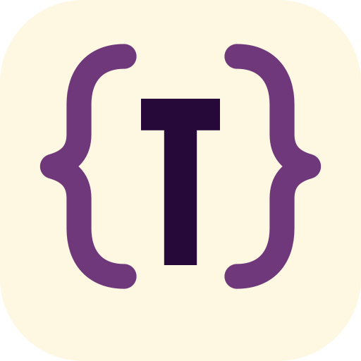

# TeXRA

**Derive it, check it, prove it.** 
Open-source AI theorist for VS Code, Cursor, Windsurf, and Antigravity.

[Quick Start](https://texra.ai/guide/quick-start) · [Programs](https://texra.ai/guide/programs) · [Lean 4](https://texra.ai/guide/lean) · [Models](https://texra.ai/guide/models) · [Desktop App](https://github.com/texra-ai/texra-desktop-releases/releases) · [GitHub](https://github.com/LionSR/TeXRA)

---

TeXRA connects frontier models inside your editor to Wolfram and Python, a live
Lean 4 server with Loogle, arXiv and Zotero, LaTeX compilation with `latexdiff`
PDFs, and parallel multi-agent scripts. Every document edit arrives as a diff
you inspect line by line.

Apache 2.0, with no TeXRA account. Bring your own API keys or provider
subscriptions; model calls go straight from your machine to the provider.

## Quick start

1. Open a project folder in VS Code (1.125+) and click the **TeXRA** icon in the
   Secondary Side Bar.
2. Connect a model in **Settings → Models** (API keys, project `.env`, or
   ChatGPT / Grok / Kimi Code / GLM subscriptions).
3. Run **`TeXRA: Run Setup Assistant`** to check your LaTeX tools, then describe
   your task in **New task** and review results in **Tasks**, VS Code's diff
   editor, or compiled `latexdiff` PDFs.

Also available as a standalone
[Desktop App](https://github.com/texra-ai/texra-desktop-releases/releases) and
[terminal CLI](https://www.npmjs.com/package/@texra-ai/cli); all three share
credentials, settings, SQLite task history, and a background service on macOS
and Linux.

## What it does

There is one assistant and no agent menu. Tell it what you need and which files
to work on; it runs shell commands, searches arXiv and Zotero, drives Lean 4,
delegates coding to Codex or Claude Code, fans large jobs out across parallel
helper agents, and runs autonomous multi-round goals verified by an independent
judge. Interrupted tasks resume from SQLite without repeating finished work, and
any task or message can be forked.

| Family       | Programs                                                                                                                 | What it returns                                               |
| :----------- | :----------------------------------------------------------------------------------------------------------------------- | :------------------------------------------------------------ |
| **Document** | `edit`, `annotate`, `enhance`, `apply`, `transcribe`, `slides`, `poster`                                                 | Compiled LaTeX and `latexdiff` PDFs                           |
| **Task**     | `review`, `search`, `derive`, `solve`, `experiment`, `code`, `review-code`, `simplify`, `test`, `fix-latex`, `latexdiff` | Research report or verified project edits                     |
| **Lean 4**   | `prove`, `lean-simplify`, `blueprint`, `lean-search`                                                                     | Proofs verified with zero errors, zero `sorry`, no new axioms |

Tailor TeXRA with `AGENTS.md`, Markdown memory, `SKILL.md` skills, Claude Code /
Codex plugins, MCP servers, and per-project approval controls
([Tailoring guide](https://texra.ai/guide/customizing)).

## Models

Direct routes to Anthropic, OpenAI, Google Gemini, DeepSeek, xAI Grok, Moonshot
Kimi, Alibaba Qwen, Zhipu GLM, MiniMax, and Meta Muse, plus ChatGPT, Grok, Kimi
Code, and GLM subscriptions and custom OpenAI Responses, Anthropic Messages, or
Gemini Interactions endpoints. Mix models freely across helper agents and
programs ([Models guide](https://texra.ai/guide/models)).

## Requirements & Docs

- **VS Code 1.125+** (or Cursor, Windsurf, Antigravity); **LaTeX + Perl** for
  compiling and diffing `.tex` files; optional Lean 4 (`lake`), WolframScript,
  ImageMagick/GraphicsMagick + Ghostscript, Codex CLI, Claude Code CLI.
- **Upgrading from 0.40?** 1.0 starts with fresh SQLite state and shared
  credentials (your research files are untouched); see the
  [Changelog](https://github.com/LionSR/TeXRA/blob/main/CHANGELOG.md).
- **Documentation:** [texra.ai/guide](https://texra.ai/guide/) ·
  [Work produced with TeXRA](https://texra.ai/work-using-texra)

## Support & License

[GitHub Issues](https://github.com/LionSR/TeXRA/issues) · [contact@texra.ai](mailto:contact@texra.ai) · [Apache-2.0](https://github.com/LionSR/TeXRA/blob/main/LICENSE) · [Terms](https://texra.ai/terms) · [Providers](https://texra.ai/providers)
