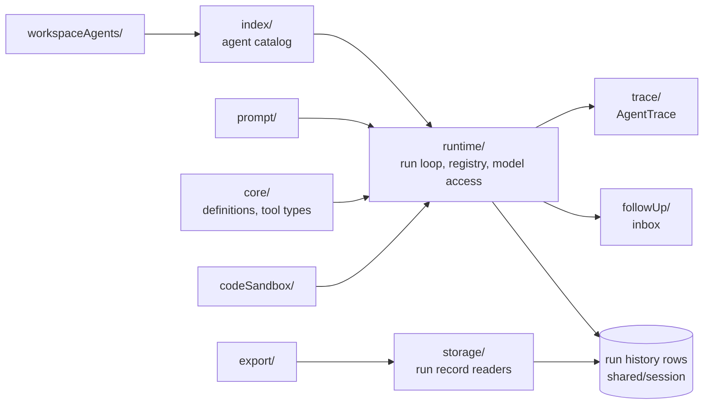

# Agent

`packages/harness/src/agent` is the harness's agent system: the domain model
of an agent and its tools, the one run program that executes it, and the
readers and services around a run. Hosts never import from here; they hold
the public `LocalSession` (`@texra-ai/harness`) and the harness reaches these
modules through the `@agent/*` alias.

| Directory          | Owns                                                                                                                                                                                                |
| ------------------ | --------------------------------------------------------------------------------------------------------------------------------------------------------------------------------------------------- |
| `core/`            | The host-agnostic domain model: agent definitions and launch configs (`definition/`), tool types and tool-call parsing (`tools/`). See `core/README.md`.                                            |
| `runtime/`         | Launching, running, resuming and reporting on runs: the run loop (`loop/`), the per-run services (`run/`), model access, the run registry and the session's event plane. See `runtime/README.md`.   |
| `followUp/`        | The session's follow-up inbox: a run's queued input as rows, the one admission path for a message (`submitFollowUp`) and the per-run reader a generation wakes on.                                  |
| `index/`           | The process's agent catalog: the agents scanned from the custom directory, the bundled directories and the loaded plugins, as one listing with each agent's source.                                 |
| `prompt/`          | The system prompt an agent opens with and the fixed template vocabulary its prompts are rendered from.                                                                                              |
| `storage/`         | Readers over a run's durable records: its result and child turns, resumability, listings, generated workspace files, the owner liveness of a claim, and the plain-text rendering of a conversation. |
| `trace/`           | `AgentTrace`, the discriminated event channel a run emits on, with its event union and the in-process emitter that fans events out to sinks.                                                        |
| `workspaceAgents/` | Which agents a workspace shows: the selection kept in workspace state and the controller that edits it.                                                                                             |
| `codeSandbox/`     | The QuickJS worker a `script` call runs in: its protocol, limits, prelude and worker entry.                                                                                                         |
| `export/`          | The format-agnostic conversation tree a completed run is exported as.                                                                                                                               |
| `debug/`           | The opt-in saver that writes a request's debug payloads beside the run.                                                                                                                             |

A run is one Effect program over its rows (`runtime/loop/toolUse.ts`); every
fact it branches on is a row the session store holds, which is why `storage/`
and `followUp/` read rows rather than runtime state. Root `CLAUDE.md` "Agent
system" and `packages/harness/AGENTS.md` "Run loop architecture" state the
contract.
