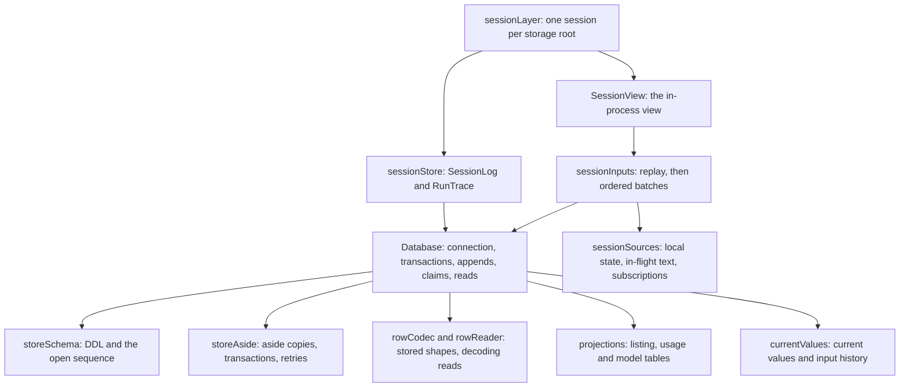

# Session store and session graph

`controllers/session` is the SQLite session store of one storage root and the
per-root session graph built over it: the database and its schema, the row
codec, the projections, the readers that turn committed rows into a session's
view, and the layer that opens and closes a session.

| File                                                | What it owns                                                                                                                     |
| --------------------------------------------------- | -------------------------------------------------------------------------------------------------------------------------------- |
| `Database.ts`                                       | The store of one root: the connection, the run history's one write path, claims, deletion and collection, and the reads.         |
| `storeSchema.ts`                                    | The tables, indexes and PRAGMAs, the schema stamp, and the open that moves a pre-1.0 or damaged file aside.                      |
| `storeAside.ts`                                     | The aside copies, the transaction wrapper and its modes, the busy and owner-proving retries, and how a failure inside one reads. |
| `rowCodec.ts`, `rowReader.ts`                       | Every stored shape: a draft encoded to its row, a selected row decoded back to an event or a typed refusal.                      |
| `projections.ts`                                    | The tables no row stores, kept by pure projectors in the append transaction and rebuilt when their version changes.              |
| `currentValues.ts`                                  | Application state that is replaced in place (`current_value`, `input_history`) and its change feed.                              |
| `sessionInputs.ts`, `sessionSources.ts`             | The ordered inputs a session's view is folded from: a replay batch, then committed rows before the live text that follows them.  |
| `SessionView.ts`, `readSessionView.ts`              | The in-process view of an open session, and a view read cold from a store without opening a session.                             |
| `sessionLayer.ts`, `sessionStore.ts`, `runTrace.ts` | The per-root session graph, its log and trace sink, and the process layer that holds one session per root.                       |
| `SessionRequests.ts`                                | The one handler for the requests a surface issues to its session's runtime.                                                      |
| `ownerLiveness.ts`, `sweepLeftoverRuns.ts`          | Whether another process that holds a run is alive, and the left-over background-shell runs a session removes at open.            |
| `appStateStore.ts`, `projectDatabase.ts`            | The process's value stores over its databases, and one shared connection per project root.                                       |
| `deletionCleanup.ts`, `localDatabasePath.ts`        | A deleted run's files on disk, and a store's SQLite path, resolved on local storage only.                                        |
| `WorkspaceRoots.ts`                                 | The storage root (and config provider) a session graph works on.                                                                 |

The commit-order and crash guarantees this store keeps are the numbered
durable invariants in the [harness README](../../../README.md#durable-invariants);
the storage format rules are in the harness `AGENTS.md` ("Storage format").
