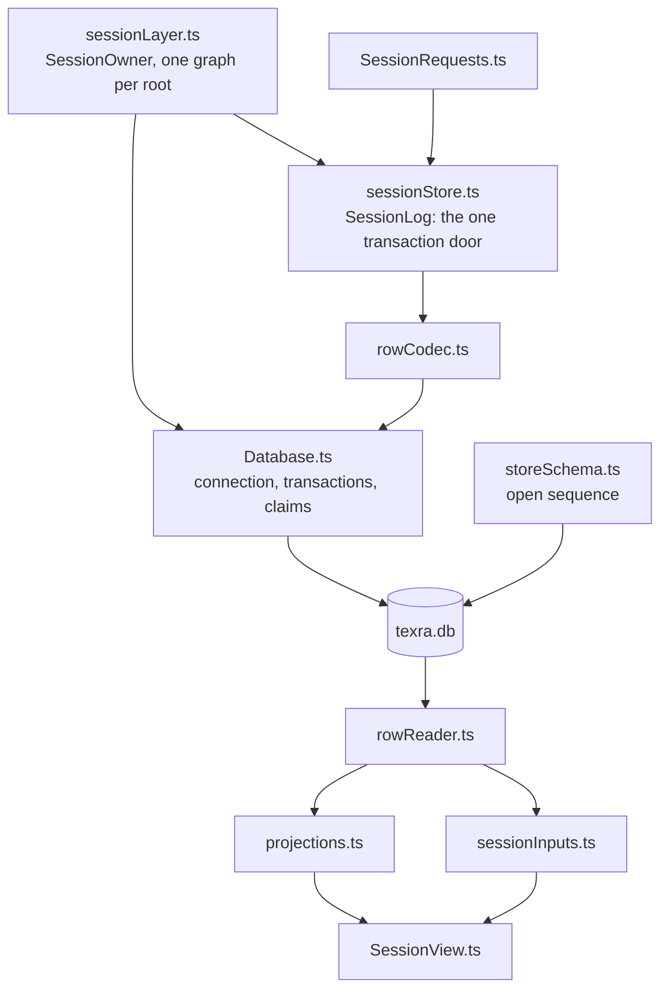

# Session controllers

`packages/harness/src/controllers/session` is the session store and the graph
built over it: the SQLite file one storage root keeps (`texra.db`), the one
write path into it, the projections rebuilt from its rows, and the
per-session services the process runtime serves to every run and every view.
The shapes it stores are defined in `@shared/session` and `@shared/schemas`;
this directory alone knows SQLite.

| Concern              | Files                                                                                                                                                                                   |
| -------------------- | --------------------------------------------------------------------------------------------------------------------------------------------------------------------------------------- |
| Physical schema      | `storeSchema.ts` (tables, PRAGMAs, the open sequence, `SCHEMA_VERSION`), `storeAside.ts` (the copies a refused store is moved to), `localDatabasePath.ts`, `projectDatabase.ts`         |
| Rows                 | `rowCodec.ts` (draft to column tuple and back, the one module that knows a stored shape), `rowReader.ts`, `rowVersions` in `@shared/schemas`                                            |
| The write path       | `Database.ts` (connection, transactions, busy retry, claims, aggregate lifetime), `sessionStore.ts` (`SessionLog`, the one transaction door; `RunTrace`, the trace sink), `runTrace.ts` |
| Projections          | `projections.ts` (the display and listing tables no row stores, each a pure function of the rows), `currentValues.ts` (application state, not history)                                  |
| Reads and the view   | `SessionView.ts` (the in-process view, updated in order), `sessionInputs.ts` (durable events before the live text after them), `sessionSources.ts`, `readSessionView.ts`                |
| Requests and policy  | `SessionRequests.ts` (every request a surface issues, answered once), `WorkspaceRoots.ts`, `appStateStore.ts`                                                                           |
| Lifetime and cleanup | `sessionLayer.ts` (one session graph per storage root under the `SessionOwner`), `ownerLiveness.ts`, `sweepLeftoverRuns.ts`, `deletionCleanup.ts`                                       |

Every write to a session's event table is a job on the `SessionEvents` inbox,
so commit order is enqueue order; `packages/harness/README.md` "Durable
invariants" numbers what the crash-conformance tests hold, and
`packages/harness/AGENTS.md` "Storage format" states the version stance.
