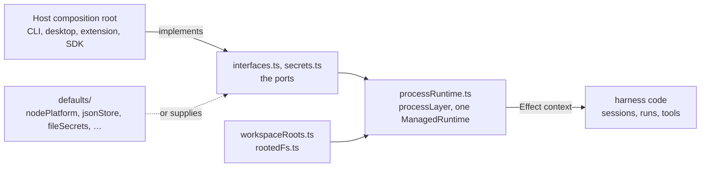

# Platform

`packages/harness/src/platform` defines the host ports as plain interfaces
and builds the process runtime that serves them. A host (the CLI, the desktop
app, the VS Code extension, an SDK embedder) implements the ports once at its
composition root; agnostic code reads them from the Effect context, never
from a host import. The directory is VS Code-free like the rest of the
harness.

| File                | Owns                                                                                                                                                                                                                                                                         |
| ------------------- | ---------------------------------------------------------------------------------------------------------------------------------------------------------------------------------------------------------------------------------------------------------------------------- |
| `interfaces.ts`     | The port contracts: config and state stores, the agent directories, the resume port, the host's process services (`AgentPlatform`).                                                                                                                                          |
| `secrets.ts`        | The `Secrets` port: API key storage and retrieval, served once per host.                                                                                                                                                                                                     |
| `workspaceRoots.ts` | The per-workspace roots: the four services whose value depends on which folder the code works on (workspace, storage, config, workspace state).                                                                                                                              |
| `rootedFs.ts`       | The rooted filesystems as services: each captures its root and refuses a path that escapes it.                                                                                                                                                                               |
| `processRuntime.ts` | `processLayer()` and the one `ManagedRuntime` per process; the named entry that may call `Effect.run*`.                                                                                                                                                                      |
| `defaults/`         | Ready-made implementations: `nodePlatform` (Node services and the supervised spawner), `nodeHost`, `jsonStore` and the JSON config provider, in-memory config and state, file-backed secrets, the model HTTP transport, process identities, storage keys, and `sdkPlatform`. |

Root `CLAUDE.md` "Separation of concerns" and `AGENTS.md` "Platform
decoupling rules" state when a new port is the answer: when agnostic code
needs a host-only capability, add a typed port served by the runtime rather
than an import.
