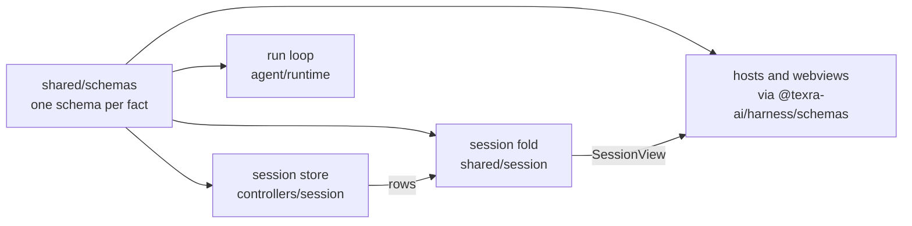

# Shared schemas

`packages/harness/src/shared/schemas` holds the wire contracts: the Effect
schemas every process agrees on, with their types derived by `typeof S.Type`.
A row the session store writes, an event a renderer applies, a setting a host
reads, a tool definition a model sees and a run's terminal outcome are all
defined here exactly once; the readers in `@shared/session`, the session
store, the run loop and every host decode against these and never carry a
second shape. The directory is browser-safe and imports nothing from
`@agent/*`.

| Family             | Files                                                                                                                                                                         |
| ------------------ | ----------------------------------------------------------------------------------------------------------------------------------------------------------------------------- |
| Session events     | `sessionEvent.ts` (the one event vocabulary), `runHistoryEvent.ts` and `rowValues.ts` (its payload shapes), `rowVersions.ts`, `sessionViewInput.ts`                           |
| Runs               | `run.ts` (the terminal outcome), `runIdentity.ts`, `identifiers.ts`, `runState.ts`, `runFacts.ts`, `runRecords.ts`, `storedTurn.ts`, `usage.ts`                               |
| Agents and tools   | `agent.ts`, `agentConfig.ts`, `agentPresets.ts`, `agentSkills.ts`, `activeSkills.ts`, `skillName.ts`, `toolDefinition.ts`, `toolResult.ts`, `offeredTools.ts`, `jsonValue.ts` |
| Requests and input | `request.ts` (the decision vocabulary), `followUp.ts`, `inquiry.ts`, `prompts.ts`, `plan.ts`, `proposalFields.ts`, `hookOutcome.ts`                                           |
| Presentation       | `progressEvents.ts`, `progressView/`, `pickerOptions.ts`, `skillDisplay.ts`, `subagentProgress.ts`, `taskGroup.ts`, `traceEvent.ts`, `log.ts`, `logPayload.ts`                |
| Settings and files | `coreSettings.ts`, `workspaceAgents.ts`, `fileFields.ts`, `output.ts`, `lineChanges.ts`, `opResults.ts`, `errors.ts`, `contextManagement.ts`, `scriptDelivery.ts`             |

Root `CLAUDE.md` "Schemas" has the rules: define the schema, derive the type,
normalize external input once at the boundary, and never read a retired
format.
