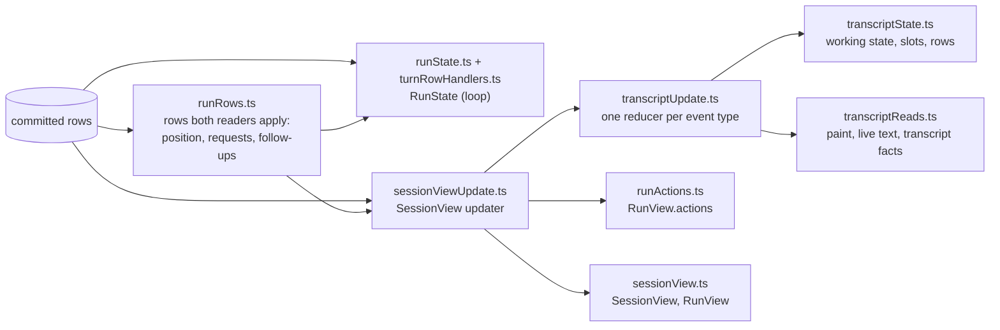

# Session rows, run state and the session view

`shared/session` turns a session's committed rows into the two things that
read them: the run state a run's loop continues from, and the session view
every host renders. It is browser-safe (no Node, no `@agent/*` imports): the
webview frontends reach it through `@texra-ai/harness/schemas`. Everything
here is a pure function of the rows it is given, except the service contracts
(`database.ts`, `runHistory.ts`, `sessionEvents.ts`, `sessionInputs.ts`),
which the controller and runtime layers implement.

| File                                                                                      | What it owns                                                                                                |
| ----------------------------------------------------------------------------------------- | ----------------------------------------------------------------------------------------------------------- |
| `runRows.ts`                                                                              | The shared rows (`run.position`, `request.*`, `followup.*`), applied once for both readers; the phase rule. |
| `runState.ts`, `turnRowHandlers.ts`, `inFlight.ts`, `runFacts.ts`                         | `RunState`: one handler per row type the loop reads, and the in-flight turn's records.                      |
| `runHistory.ts`, `historyTurns.ts`                                                        | `RunHistory` and its run cell, the one writer of a run's rows; those rows in the loop's terms.              |
| `sessionView.ts`, `readonlyViews.ts`                                                      | The view's shape (schemas, derived types) and the rules every host reads off it.                            |
| `sessionViewUpdate.ts`                                                                    | The updater: events, chunks, the local snapshot and subscriptions onto the view.                            |
| `transcriptUpdate.ts`, `transcriptState.ts`, `transcriptReads.ts`, `transcriptLogRows.ts` | A run's transcript: the reducer, its working state, painting with live text, and the `log` rows.            |
| `database.ts`, `valueFamily.ts`                                                           | The store contract: errors, the `Database` service, current values and their families.                      |
| `runtimeRequest.ts`, `approvalDecision.ts`, `runRelation.ts`                              | The requests a surface sends its runtime, how a run reads an answer, and where two runs stand in the tree.  |
