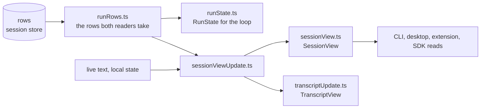

# Shared session

`packages/harness/src/shared/session` is the session fold: the pure functions
that turn a session's rows into the `SessionView` every renderer reads and
the `RunState` the run loop continues from. It is browser-safe (a webview
runs the same fold over the wire), imports nothing from `@agent/*`, and
holds no SQLite; the store that feeds it is `controllers/session`.

| Concern            | Files                                                                                                                                                                             |
| ------------------ | --------------------------------------------------------------------------------------------------------------------------------------------------------------------------------- |
| The store contract | `database.ts` (the root-scoped event store as the fold sees it), `sessionInputs.ts`, `sessionEvents.ts` (the publisher and the exhaustive event readers)                          |
| Run history        | `runHistory.ts` (the one reader of run-history payloads and the one writer of the rows a run rebuilds from), `runRows.ts`, `historyTurns.ts`, `turnRowHandlers.ts`, `inFlight.ts` |
| Run state          | `runState.ts` (a run rebuilt from its rows), `runFacts.ts`, `runActions.ts` (which actions a state licenses), `runRelation.ts`, `approvalDecision.ts`, `runtimeRequest.ts`        |
| The session view   | `sessionView.ts` (the one state every renderer reads), `sessionViewUpdate.ts` (events, live text and local state applied to it), `readonlyViews.ts`, `readonlyDeep.ts`            |
| Transcripts        | `transcriptUpdate.ts` (the one transcript reducer), `transcriptState.ts`, `transcriptReads.ts`, `transcriptLogRows.ts`, `valueFamily.ts`                                          |

The fold is a function of the rows: nothing here holds state a row does not
record, which is what lets the live path and the resume path be one function
(`packages/harness/AGENTS.md` "Run loop architecture").
