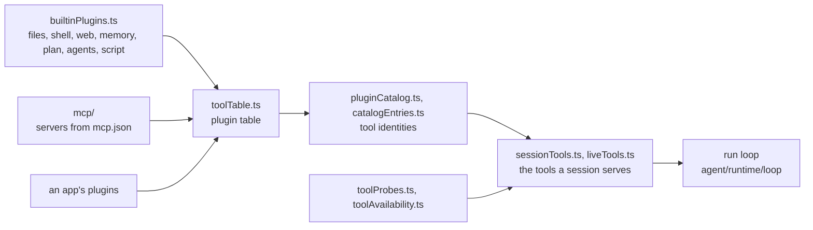

# Tools

`packages/harness/src/tools` holds the harness's built-in plugins and the
catalog that serves them: what a plugin is (`plugins.ts`), the tools the
built-ins contribute, and the process and session layers that load, probe
and list them. A tool is plain data plus a `call` (`core/definition.ts`);
the run loop decides when a call runs and records its result, and nothing
here appends to a run's history.

| Concern           | Files                                                                                                                                                                                                 |
| ----------------- | ----------------------------------------------------------------------------------------------------------------------------------------------------------------------------------------------------- |
| What a plugin is  | `plugins.ts`, `core/` (definition, input schema spellings, results), `builtinPlugins.ts` (the harness's built-ins as one list)                                                                        |
| The catalog       | `toolTable.ts` (the plugin table by id), `pluginCatalog.ts` and `catalogEntries.ts` (each tool's identity and digest), `schemaIdentity.ts`, `liveTools.ts`, `sessionTools.ts` (one project's side)    |
| Availability      | `toolProbes.ts`, `toolAvailability.ts`, `toolAvailabilityService.ts` (each workspace's last probe results), `interruptedTasks.ts`                                                                     |
| Files and shell   | `ReadTool.ts`, `WriteTool.ts`, `EditTool.ts`, `fileEditFlow.ts`, `approval/`, `bash.ts`, `glob.ts`, `grep.ts`, `gitignore.ts`, `pathResolution.ts`, `formatting.ts`, `attachments.ts`, `emlParser.ts` |
| Runs and children | `ExecutionsTool.ts` with `executions/`, `delegation/` (the `agent` tool and the child-run launch paths), `codemode/` (the `script` tool and its sandboxed discovery)                                  |
| The rest          | `memory/`, `plan/`, `web/`, `mcp/` (MCP servers as loaded plugins), `jsonRpc.ts`, `timeouts.ts`, `structuredOutput.ts`, `agentCatalogFollower.ts`                                                     |

`packages/harness/AGENTS.md` "Tool input schemas" has the rule every input
schema follows (`Schema.optional(Schema.NullOr(S))`), and root `CLAUDE.md`
"One publisher, loop-owned cards" says why a tool never writes its own card.
